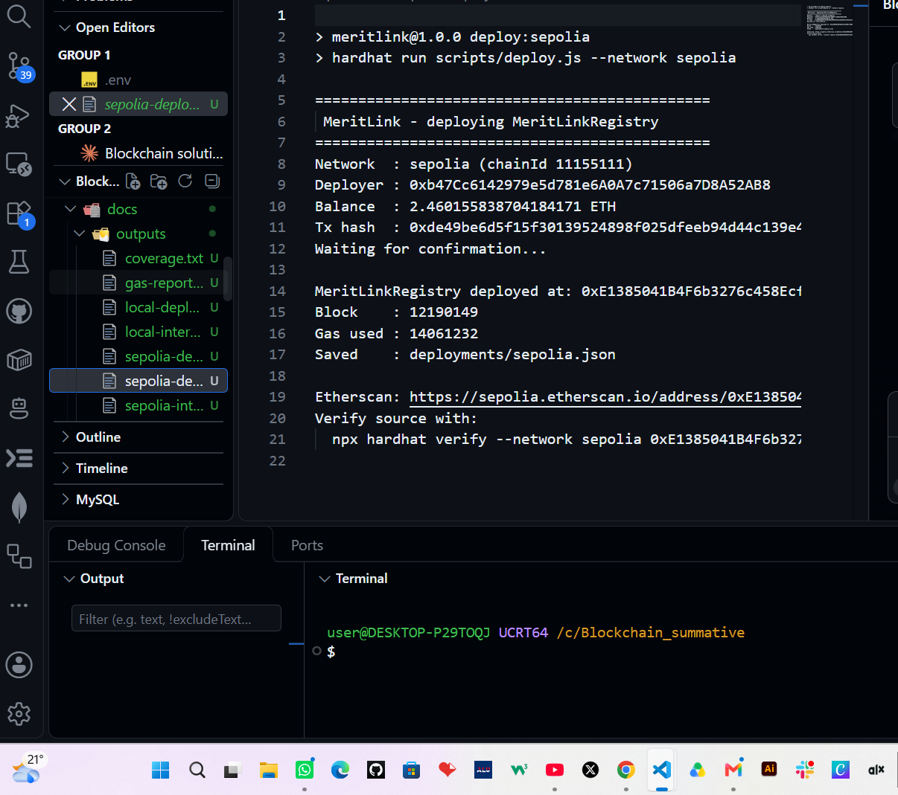
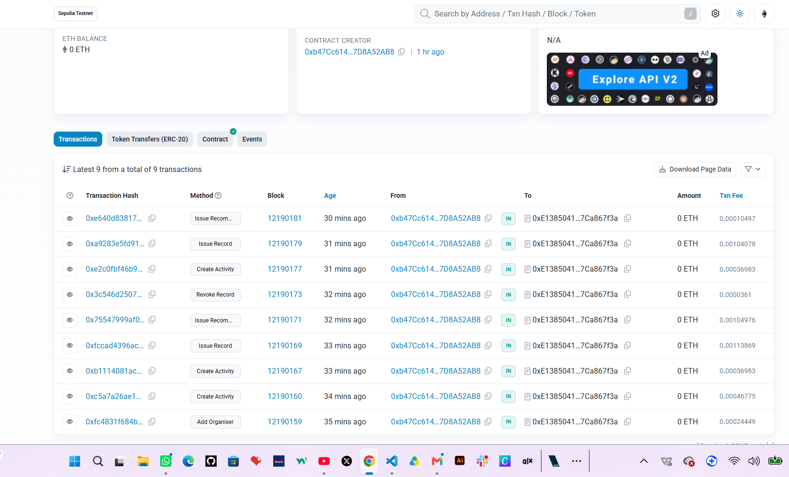
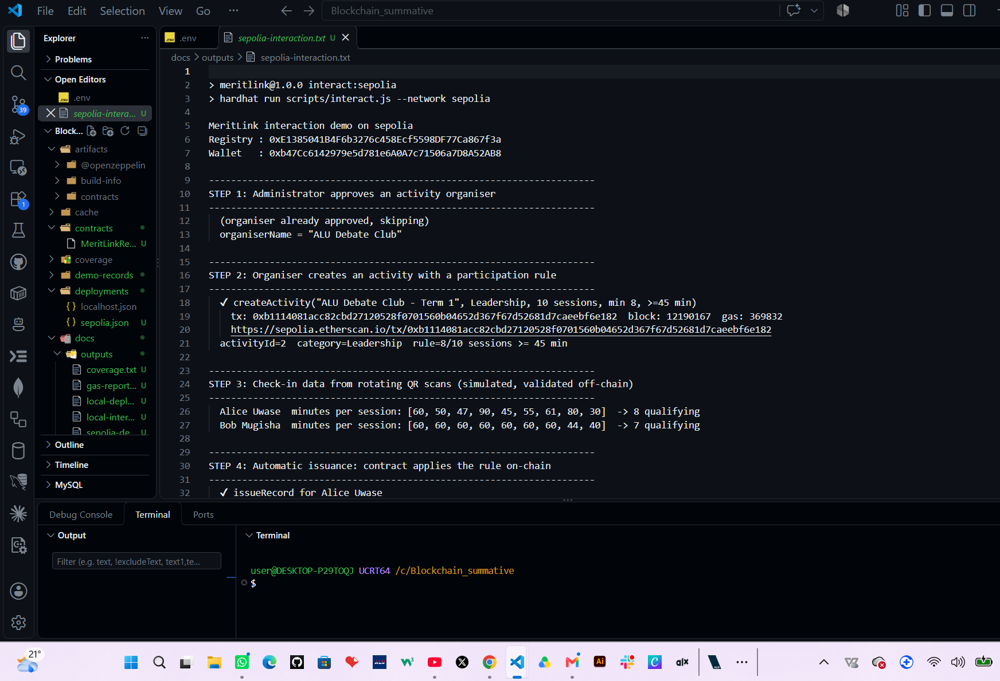
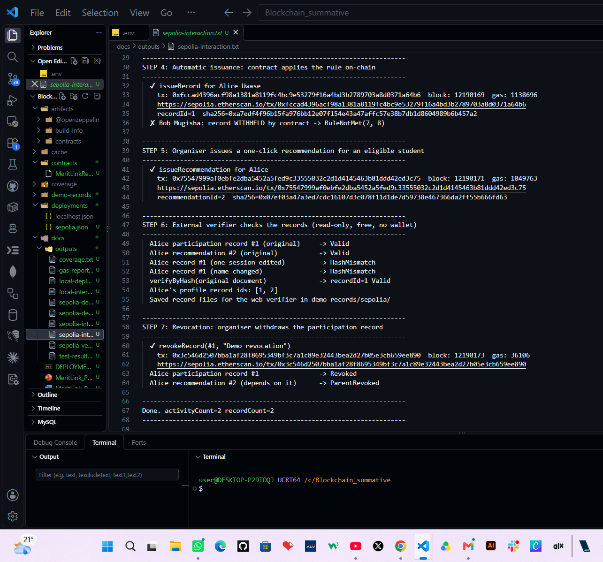
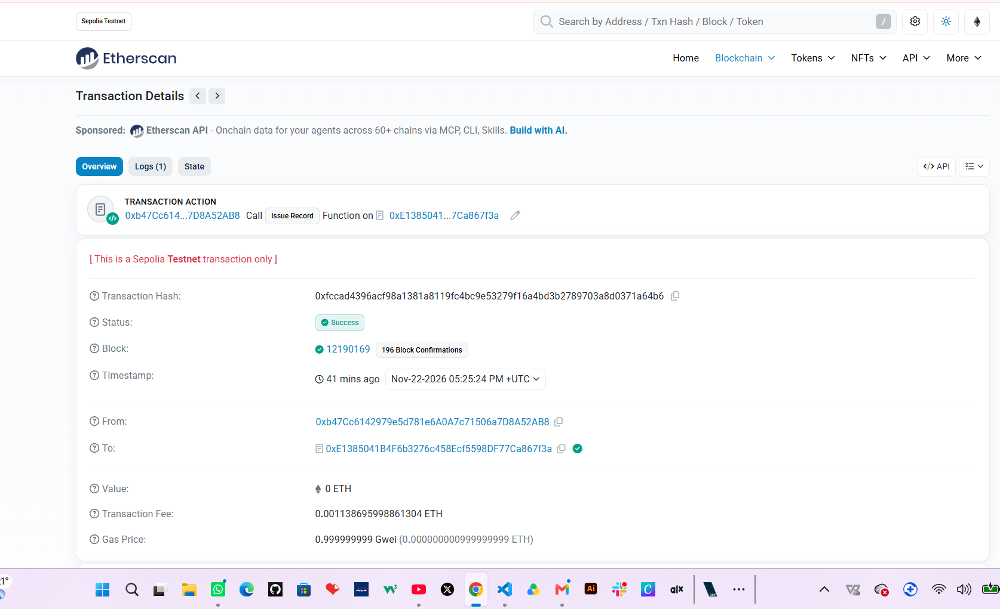
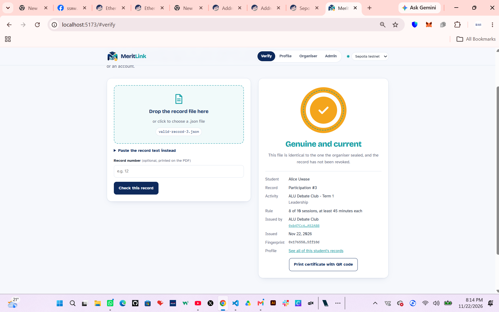
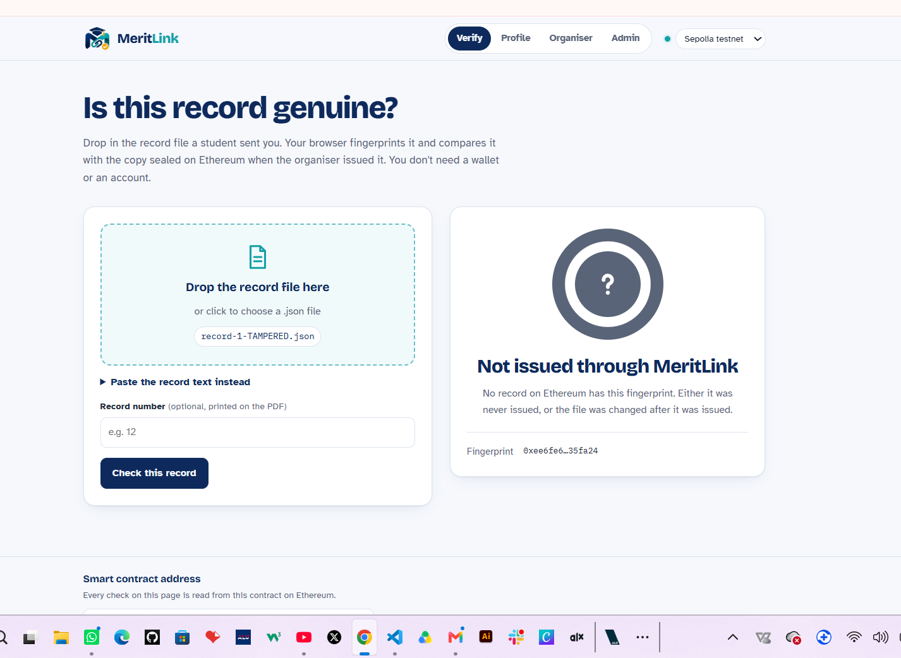
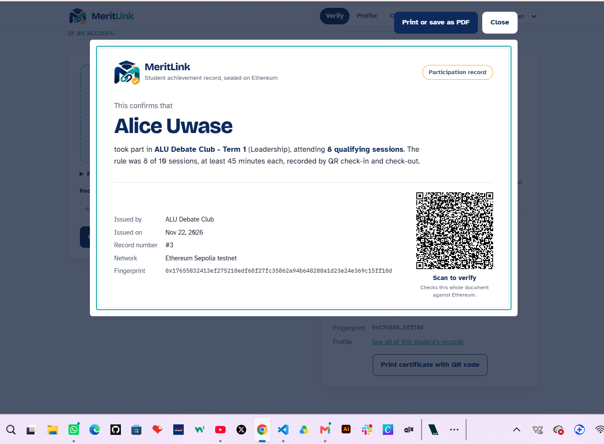

# MeritLink: Developing a Blockchain-Based Solution for Verifying Student Extracurricular Achievements in Education

**Student:** Deng Mayen Deng Akol  
**Programme:** BSc Software Engineering, African Leadership University  
**Course:** Blockchain, Summative Assessment  
**Application area:** Education (with an identity-management component)  
**Network:** Ethereum Sepolia testnet  
**Source code:** https://github.com/dengtiel/meritlink  
**Smart contract (Sepolia, source verified):** https://sepolia.etherscan.io/address/0xE1385041B4F6b3276c458Ecf5598DF77Ca867f3a#code  
**Date:** November 2026  

---

## Contents

1. Problem identification
2. Alignment with my mission
3. Solution design
4. Smart contract development
5. Implementation and deployment
6. Validation and testing
7. Limitations and next steps toward the capstone
8. Conclusion
9. References

Appendices: [Deployment guide](DEPLOYMENT_GUIDE.md) · [Test cases](TEST_CASES.md) · terminal outputs in [docs/outputs](outputs/)

---

## 1. Problem identification

At university, a lot of what students learn happens outside the classroom: running a club, volunteering, mentoring first-years, sitting on the student guild. Jackson and Bridgstock (2021) found that these co-curricular and extracurricular experiences contribute to graduates' skills, networks and job prospects. Ragui (2025) reached a similar conclusion in a tracer study of Kenyan ENACTUS graduates and recommended that universities formally recognise this kind of participation.

The trouble is what happens when a student tries to prove any of it. An academic transcript lists courses and grades. Evidence of leadership or volunteering ends up scattered across emails, paper certificates, WhatsApp groups and club spreadsheets, and some of it was never recorded at all. When a student applies for an internship or a scholarship, the reviewer has two options. They can take the claim on trust, or they can chase the club leader by email to confirm it. Neither works well. Trust is easy to abuse, and confirming every claim by hand doesn't scale.

Existing tools cover part of this. LinkedIn lets people list skills and collect endorsements, but an endorsement only shows that someone clicked a button. It doesn't show that a student attended an activity (LinkedIn, n.d.). Blockcerts and similar systems issue tamper-evident certificates on a blockchain, but they are built for formal qualifications issued by an institution (OECD, 2021). They don't cover the many small, recurring activities that make up student life. Reviews of blockchain in education (Grech & Camilleri, 2017; Alammary et al., 2019) and of certificate verification systems (Rustemi et al., 2023) show the same focus: most work verifies formal academic credentials, not everyday participation.

**The specific problem this project addresses:** there is no low-effort way for an activity organiser to produce trustworthy participation records, and no way for an outside reviewer to check those records independently without contacting anyone.

One point from the proposal shapes the whole design. A blockchain can show that a record has not been changed since it was issued. It cannot show that the activity actually happened (Grech et al., 2021). Something outside the chain has to supply that evidence. MeritLink's answer is to capture it while the activity is taking place, through time-limited QR check-in and check-out scans, rather than asking staff to review claims afterwards.

## 2. Alignment with my mission

My personal mission is to empower African youth through mentorship, quality education and career opportunities, using technology and innovation. MeritLink connects to that mission directly. The students who gain most from verifiable extracurricular records are often the ones whose transcripts don't tell the whole story: first-generation students, students from under-resourced schools, and students who spent their energy building a campus community rather than chasing a perfect GPA. A record a scholarship committee can check in thirty seconds gives that work the same weight as a grade.

The project also fits two UN Sustainable Development Goals. SDG 8 (Decent Work and Economic Growth): it helps young people present evidence of transferable skills when they look for work. SDG 4 (Quality Education): it recognises learning that happens beyond formal classes. I am not claiming the platform will reduce youth unemployment. That would need a long-term study well beyond this course. The narrower claim, which this prototype tests, is that verified records can be produced automatically and checked by anyone.

## 3. Solution design

### 3.1 Overview

MeritLink is a Linktree-style profile. A student shares one link that lists every verified activity record and recommendation they hold. The system has three layers:

```
 ┌────────────────────── OFF-CHAIN (web app + database) ──────────────────────┐
 │                                                                            │
 │  Organiser dashboard      Student phone               Platform database    │
 │  - create activity  ───►  - scans rotating QR  ───►   - names, emails      │
 │  - set rule once          - check-in + check-out      - full record JSON   │
 │                           - one location reading      - recommendation text│
 │                                                             │              │
 │              attendance minutes per session ─────────────── │              │
 └─────────────────────────────────────────────────────────────┼──────────────┘
                                                               │
              issueRecord(activityId, studentRef, sha256(record), minutes[])
                                                               ▼
 ┌────────────────────── ON-CHAIN (MeritLinkRegistry, Sepolia) ───────────────┐
 │  - who may issue (roles)          - activity rule (8 of 10, ≥45 min)       │
 │  - re-applies the rule            - SHA-256 fingerprint + issuer + date    │
 │  - revocation status              - pseudonymous student index             │
 └────────────────────────────────────────────────────────────────────────────┘
                                                               ▲
                     verifyRecord(id, sha256(document they hold))   (free, no wallet)
                                                               │
                         Employer / scholarship committee / university
```

### 3.2 What goes on-chain and what does not

I kept personal data off the chain completely. Once something is written to a public blockchain it cannot be deleted. That conflicts with basic data-protection expectations, including Rwanda's 2021 law on personal data protection and privacy. The contract therefore stores:

| On-chain (public, permanent) | Off-chain (access-controlled database) |
|---|---|
| SHA-256 fingerprint of each record | Student name and email |
| Issuing organiser's address and public name | Full record document |
| Activity name, category and participation rule | Recommendation text |
| Qualifying session count, issue date, revocation status | Raw scan data (QR token, timestamps, location reading) |
| `studentRef` = keccak256(secret salt + email) | The salt itself |

The `studentRef` lets the contract list a student's records for their profile page. Because the platform's secret salt is mixed in, nobody can work backwards from the reference to an email address.

### 3.3 Key features

1. **Role-based access.** A university administrator approves organisers. Only approved organisers can create activities and issue records, and only for their own activities.
2. **Participation rules published on-chain.** An organiser defines the rule once, for example "8 of 10 sessions, each at least 45 minutes". Anyone can read it.
3. **Automatic, rule-enforced issuance.** The organiser's dashboard submits the minutes each student attended, as measured by the check-in and check-out scans. The contract counts the qualifying sessions itself and refuses to issue a record if the rule is not met. Even the organiser cannot override this.
4. **Recommendations tied to participation.** An organiser can only recommend a student who already holds a valid participation record in that organiser's activity, and only once per record.
5. **Public verification.** Anyone can hash the document they were given and call `verifyRecord` or `verifyByHash`. These are `view` functions, so they cost nothing and need no wallet.
6. **Revocation.** The issuer or the administrator can revoke a record. Recommendations built on a revoked record are reported as `ParentRevoked`.
7. **Emergency pause.** If an organiser's key is compromised, the administrator can freeze all issuance. Verification keeps working.
8. **Printable certificates with a verification QR code.** Every participation record and recommendation can be printed or saved as a PDF certificate. The QR code carries the whole record, compressed, so scanning a paper copy rebuilds the document in the verifier's browser and checks it against the chain, including the student's name. An edited printout or a forged QR gives "altered". Long recommendation letters that would make the QR too dense fall back to a fingerprint-only QR, and the certificate says so.
9. **Linktree-style profile link.** A student shares one link (`#profile=0x…`) that lists every record they hold, each with its live verification status.

### 3.4 The role of the smart contract

Without a smart contract, MeritLink would be an ordinary database with a "verified" badge, and the platform operator could quietly edit or invent records. The contract removes that trust requirement in four ways:

- **Integrity.** Once a fingerprint is anchored, any change to the document, even a single minute of attendance, gives a different hash. Verification then reports `HashMismatch`.
- **Rule enforcement.** The participation rule is checked by code anyone can read on Etherscan, not by a person.
- **Accountability.** Every record names the address that issued it, and every issuance and revocation is a permanent, timestamped event.
- **Independence.** A verifier in another country can check a record directly against Ethereum without trusting MeritLink's servers.

### 3.5 Why Ethereum and why Sepolia

The assignment requires Ethereum. Ethereum is also a good fit on the merits: its tooling (Hardhat, OpenZeppelin, Etherscan) is mature, and any verifier can read a public chain without permission. Sepolia is Ethereum's main testnet. It behaves like mainnet but uses free test ETH, which suits a pilot. Section 7 covers what a production deployment would change.

## 4. Smart contract development

**File:** [`contracts/MeritLinkRegistry.sol`](../contracts/MeritLinkRegistry.sol) (523 lines, about half of them NatSpec comments)
**Compiler:** Solidity 0.8.24, optimizer on (200 runs), EVM target Cancun
**Libraries:** OpenZeppelin Contracts 5.x (`AccessControl`, `Pausable`)

### 4.1 Data model

```solidity
enum Category { Leadership, Volunteering, StudentOrganisation, Mentorship, CommunityEngagement }
enum RecordKind { Participation, Recommendation }
enum RecordStatus { None, Valid, Revoked }
enum VerificationResult { NotFound, Valid, Revoked, HashMismatch, ParentRevoked }

struct Activity {
    address organiser;
    uint16 totalSessions;
    uint16 minSessions;
    uint16 minMinutesPerSession;
    uint64 createdAt;
    bool active;
    Category category;
    string name;
}

struct Record {
    bytes32 recordHash;      // SHA-256 of the off-chain document
    bytes32 studentRef;      // salted pseudonym, never an email
    uint256 activityId;
    uint256 parentRecordId;  // recommendations point at their participation record
    address issuer;
    uint64 issuedAt;
    uint64 revokedAt;
    uint16 qualifyingSessions;
    RecordKind kind;
    RecordStatus status;
}
```

I used small integer types (`uint16`, `uint64`) and grouped them next to each other so the compiler packs several fields into one 32-byte storage slot. Fewer slots means less gas per write.

### 4.2 Functions

| Function | Who can call | What it does |
|---|---|---|
| `addOrganiser(addr, name)` / `removeOrganiser(addr)` | Admin | Approve or remove an organiser |
| `pause()` / `unpause()` | Admin | Emergency stop for all writes |
| `createActivity(name, category, total, min, minutes)` | Organiser | Publish an activity and its rule |
| `closeActivity(id)` | That activity's organiser | Stop further issuance |
| `issueRecord(activityId, studentRef, hash, minutes[])` | That activity's organiser | Apply the rule and anchor the record |
| `issueRecommendation(participationId, hash)` | That activity's organiser | Anchor a recommendation for an eligible student |
| `revokeRecord(id, reason)` | Issuer or admin | Mark a record as revoked |
| `verifyRecord(id, hash)` | Anyone (free) | Return `Valid` / `Revoked` / `HashMismatch` / `NotFound` / `ParentRevoked` |
| `verifyByHash(hash)` | Anyone (free) | Same check when only the document is known |
| `getRecord`, `getActivity`, `getStudentRecords`, `isOrganiser` | Anyone (free) | Read data for the profile and verifier pages |

### 4.3 The core logic: enforcing the rule on-chain

This is the function that turns check-in data into a record:

```solidity
function issueRecord(
    uint256 activityId,
    bytes32 studentRef,
    bytes32 recordHash,
    uint16[] calldata attendedMinutes
) external onlyActivityOrganiser(activityId) whenNotPaused returns (uint256 recordId) {
    Activity storage a = _activities[activityId];
    if (!a.active) revert ActivityClosedError(activityId);
    if (studentRef == bytes32(0)) revert InvalidStudentRef();
    _requireFreshHash(recordHash);

    uint256 existing = participationRecordOf[activityId][studentRef];
    if (existing != 0) revert AlreadyIssued(activityId, studentRef, existing);

    // Apply the participation rule on-chain.
    uint16 qualifying = _countQualifyingSessions(a, attendedMinutes);
    if (qualifying < a.minSessions) revert RuleNotMet(qualifying, a.minSessions);

    recordId = _storeRecord(recordHash, studentRef, activityId, 0, qualifying, RecordKind.Participation);
    participationRecordOf[activityId][studentRef] = recordId;
}
```

My first plan was simpler: the web app would decide whether a student qualified and the contract would just store a hash. I changed it because that design leaves the most important decision off-chain, where the platform could fake it. With the minutes passed in, anyone can see on Etherscan exactly what attendance a record was based on, and the contract refuses to issue a record that breaks the published rule. The array is capped at the activity's `totalSessions` (itself at most 200), so a caller can't pad it with fake sessions and the loop has a bounded cost.

### 4.4 Verification

```solidity
function verifyRecord(uint256 recordId, bytes32 candidateHash) public view returns (VerificationResult) {
    Record storage r = _records[recordId];
    if (r.status == RecordStatus.None) return VerificationResult.NotFound;
    if (r.recordHash != candidateHash) return VerificationResult.HashMismatch;
    if (r.status == RecordStatus.Revoked) return VerificationResult.Revoked;
    if (r.kind == RecordKind.Recommendation && _records[r.parentRecordId].status != RecordStatus.Valid)
        return VerificationResult.ParentRevoked;
    return VerificationResult.Valid;
}
```

On the off-chain side, [`scripts/lib/record.js`](../scripts/lib/record.js) and the web page use the same algorithm to produce the hash: sort every object's keys, serialise to JSON, then SHA-256. Sorting matters. Without it, two copies of the same record whose fields happen to be in a different order would produce different hashes and fail verification for no real reason. Test TC-31 covers this case.

### 4.5 Security measures

| Risk | Measure in the contract |
|---|---|
| Unauthorised issuance | OpenZeppelin `AccessControl`; `onlyActivityOrganiser` modifier checks both the role and ownership of the activity |
| Organiser issuing for someone else's club | Activity ownership check (TC-20, TC-25) |
| Records that break the rule | Rule re-applied on-chain; `RuleNotMet` revert (TC-13, TC-14) |
| Inflated attendance | `TooManySessions` if more sessions are submitted than the activity has (TC-16) |
| Duplicate records / replayed hashes | `AlreadyIssued` and `HashAlreadyAnchored` (TC-17, TC-18) |
| Compromised organiser key | Admin can `pause`, remove the organiser and revoke their records (TC-06, TC-37, TC-40) |
| Personal data leaking on-chain | Only hashes and a salted pseudonym are stored (TC-22) |
| Re-entrancy | The contract holds no ether and makes no external calls, so there is nothing to re-enter |
| Integer overflow | Solidity 0.8 checked arithmetic. The one `unchecked` increment is bounded by `MAX_SESSIONS` |
| Unbounded gas | Session loop capped at 200; revocation reasons kept in event logs, not in storage |

OpenZeppelin's access-control module is widely used and audited (OpenZeppelin, 2024), so I relied on it instead of writing my own role checks.

I used custom errors (`error RuleNotMet(uint16 qualifying, uint16 required)`) instead of revert strings. They are cheaper to deploy and to revert with, and they carry the actual numbers. That is how the interaction script can print "Bob: record WITHHELD → `RuleNotMet(7, 8)`" instead of a generic failure.

## 5. Implementation and deployment

### 5.1 Project structure

```
Blockchain_summative/
├── contracts/MeritLinkRegistry.sol   smart contract
├── test/MeritLinkRegistry.test.js    42 test cases
├── scripts/
│   ├── deploy.js                     deploy + save address
│   ├── interact.js                   full pilot walkthrough
│   ├── verify-etherscan.js           publish source on Etherscan
│   ├── issue-demo.js                 issue a valid record + recommendation for demos
│   ├── serve-frontend.js             local web server
│   └── lib/record.js                 canonical JSON + SHA-256 + studentRef
├── frontend/index.html               verifier, profile, certificates, organiser and admin pages
├── frontend/assets/                  MeritLink logo and favicon
├── deployments/                      saved addresses per network
├── docs/                             this report, guide, test cases, outputs
└── hardhat.config.js
```

### 5.2 Deployment steps (summary)

Full instructions are in the [Deployment Guide](DEPLOYMENT_GUIDE.md).

1. `npm install`
2. Copy `.env.example` to `.env`. Add the Sepolia RPC URL, a test-wallet private key and an Etherscan API key.
3. `npm run deploy:sepolia` deploys the contract and writes `deployments/sepolia.json`.
4. `npm run verify:sepolia` publishes the source on Etherscan.
5. `npm run interact:sepolia` runs the whole pilot scenario on-chain.

### 5.3 Deployment results

**Local Hardhat network** (output in [outputs/local-deploy.txt](outputs/local-deploy.txt)):

```
MeritLinkRegistry deployed at: 0x5FbDB2315678afecb367f032d93F642f64180aa3
Block    : 1
Gas used : 2003884
```

**Sepolia testnet** (output in [outputs/sepolia-deploy.txt](outputs/sepolia-deploy.txt) and [outputs/sepolia-verify.txt](outputs/sepolia-verify.txt)):

| Item | Value |
|---|---|
| Contract address | `0xE1385041B4F6b3276c458Ecf5598DF77Ca867f3a` |
| Deployment transaction | `0xde49be6d5f15f30139524898f025dfeeb94d44c139e413c43f72531e3c12ec7a` |
| Block | 12,190,149 (22 November 2026) |
| Deployer / administrator | `0xb47Cc6142979e5d781e6A0A7c71506a7D8A52AB8` |
| Gas used | 14,061,232 at 1 gwei (about 0.014 Sepolia ETH) |
| Etherscan | https://sepolia.etherscan.io/address/0xE1385041B4F6b3276c458Ecf5598DF77Ca867f3a |
| Source verified | Yes: https://sepolia.etherscan.io/address/0xE1385041B4F6b3276c458Ecf5598DF77Ca867f3a#code |

```
Network  : sepolia (chainId 11155111)
Deployer : 0xb47Cc6142979e5d781e6A0A7c71506a7D8A52AB8
Tx hash  : 0xde49be6d5f15f30139524898f025dfeeb94d44c139e413c43f72531e3c12ec7a
MeritLinkRegistry deployed at: 0xE1385041B4F6b3276c458Ecf5598DF77Ca867f3a
Block    : 12190149
Gas used : 14061232

Successfully verified contract MeritLinkRegistry on the block explorer.
https://sepolia.etherscan.io/address/0xE1385041B4F6b3276c458Ecf5598DF77Ca867f3a#code
```



*Figure 1: Deploying MeritLinkRegistry to Sepolia (npm run deploy:sepolia).*



*Figure 2: The contract on Sepolia Etherscan, listing every transaction from the deployment, the demo and the valid demo record.*

The verified Solidity source can be read on Etherscan's Contract tab: https://sepolia.etherscan.io/address/0xE1385041B4F6b3276c458Ecf5598DF77Ca867f3a#code

### 5.4 Interaction results

This is the output of `scripts/interact.js` on Sepolia ([full log](outputs/sepolia-interaction.txt)). Every transaction can be opened on Etherscan. The same run on the local network is in [outputs/local-interaction.txt](outputs/local-interaction.txt).

```
STEP 2: Organiser creates an activity with a participation rule
  ✔ createActivity("ALU Debate Club - Term 1", Leadership, 10 sessions, min 8, >=45 min)
    tx: 0xb1114081acc82cbd27120528f0701560b04652d367f67d52681d7caeebf6e182  block: 12190167

STEP 4: Automatic issuance: contract applies the rule on-chain
  ✔ issueRecord for Alice Uwase
    tx: 0xfccad4396acf98a1381a8119fc4bc9e53279f16a4bd3b2789703a8d0371a64b6  block: 12190169  gas: 1138696
    recordId=1  sha256=0xa7edf4f96b15fa976bb12e07f154e43a47affc57e38b7db1d8604989b6b457a2
  ✘ Bob Mugisha: record WITHHELD by contract -> RuleNotMet(7, 8)

STEP 5: Organiser issues a one-click recommendation for an eligible student
  ✔ issueRecommendation for Alice
    tx: 0x75547999af0ebfe2dba5452a5fed9c33555032c2d1d4145463b81ddd42ed3c75  block: 12190171
    recommendationId=2

STEP 6: External verifier checks the records (read-only, free, no wallet)
  Alice participation record #1 (original)     -> Valid
  Alice recommendation #2 (original)           -> Valid
  Alice record #1 (one session edited)         -> HashMismatch
  Alice record #1 (name changed)               -> HashMismatch
  verifyByHash(original document)              -> recordId=1 Valid
  Alice's profile record ids: [1, 2]

STEP 7: Revocation: organiser withdraws the participation record
  ✔ revokeRecord(#1, "Demo revocation")
    tx: 0x3c546d2507bba1af28f8695349bf3c7a1c89e32443bea2d27b05e3cb659ee890  block: 12190173
  Alice participation record #1                -> Revoked
  Alice recommendation #2 (depends on it)      -> ParentRevoked
```

Because the demo revokes Alice's record at the end, I also ran `scripts/issue-demo.js` on Sepolia. It left a valid participation record (#3) and recommendation (#4) for the certificate and QR demonstration ([log](outputs/sepolia-demo-record.txt)).

Bob attended nine sessions, but two of them were shorter than 45 minutes. The contract counted seven qualifying sessions and refused to issue his record. Nobody had to review his case by hand. The decision came from the rule his organiser published.



*Figure 3: Interaction script on Sepolia, steps 1 to 4: organiser, activity with its rule, and check-in data.*



*Figure 4: Interaction script on Sepolia, steps 4 to 7: Alice issued, Bob refused with RuleNotMet(7, 8), recommendation, verification, tamper detection and revocation.*



*Figure 5: Alice's issueRecord transaction on Etherscan: status Success in block 12190169.*

### 5.5 The web page on Sepolia

The web page (`npm run frontend`) connects to the Sepolia contract on its own. A verifier needs no wallet: they drop in the record file, and the browser computes its SHA-256 fingerprint and asks the contract about it.



*Figure 6: Verifying valid record #3: the fingerprint matches the sealed record, so the page shows "Genuine and current" with the activity, rule and issuer read from the chain.*



*Figure 7: Verifying an edited copy of record #1: its fingerprint was never sealed, so the page shows "Not issued through MeritLink".*



*Figure 8: Printable certificate for record #3. The QR code carries the whole record, so scanning a paper copy checks it against Ethereum.*

## 6. Validation and testing

### 6.1 Approach

I wrote the tests with Hardhat, Mocha and Chai. Each test starts from a clean snapshot of the chain using `loadFixture`, so no test depends on another. The tests are grouped by feature, and each starts with an ID (TC-01 to TC-42) that matches the table in [TEST_CASES.md](TEST_CASES.md). For every function I tested three kinds of case:

- the expected path (a qualifying student gets a record),
- the failure paths (wrong caller, broken rule, bad input), checking the exact custom error and its arguments,
- boundary values (exactly 45 minutes and exactly 8 sessions should pass; 44 minutes should not count).

### 6.2 Results

```
  42 passing (1s)
```

| Group | Tests | Passed |
|---|---|---|
| Deployment and administration | 6 | 6 |
| Activities and rules | 5 | 5 |
| Rule-based issuance | 11 | 11 |
| Recommendations | 6 | 6 |
| Verification / tamper detection | 7 | 7 |
| Revocation | 4 | 4 |
| Emergency pause | 2 | 2 |
| End-to-end scenario | 1 | 1 |
| **Total** | **42** | **42** |

**Coverage** (`npx hardhat coverage`):

| File | Statements | Branches | Functions | Lines |
|---|---|---|---|---|
| MeritLinkRegistry.sol | 100% | 97.83% | 100% | 100% |

### 6.3 Gas costs

| Function | Local Hardhat (average) | Sepolia (measured) |
|---|---|---|
| Deployment | 2,003,884 | 14,061,232 |
| `addOrganiser` | 74,479 | 244,490 |
| `createActivity` | 120,245 | 369,832 |
| `issueRecord` | 258,437 | 1,138,696 |
| `issueRecommendation` | 249,683 | 1,049,763 |
| `revokeRecord` | 34,893 | 36,106 |
| `verifyRecord` (read) | 0 | 0 |

The two columns differ a lot, and I did not expect that. The bytecode is identical, so I looked into it. Sepolia activated Ethereum's next upgrade, Glamsterdam, on 6 October 2026. One of its changes, EIP-8037, raises the gas price of *creating new state*: the code deposit per byte goes from 200 to 1,530 gas, and a new storage slot from 20,000 to 97,920. Hardhat's local network still runs the older rules. The numbers fit this explanation. Deploying 8.3 KB of bytecode at 1,530 gas per byte is about 12.7 million gas on its own. `revokeRecord` only updates storage that already exists, and it barely changed (34,893 → 36,106).

Sepolia ETH is free, so none of this costs real money here. It does matter for the design. Under Glamsterdam pricing, a mainnet record costs over a million gas, about four times what the local tests suggested. That makes batching records per session much more important (section 7).

### 6.4 A problem I hit during testing

The first full test run had 40 of 42 tests failing with `Invalid Chai property: revertedWithCustomError`. The contract was fine. VS Code had opened the project as `c:\Blockchain_summative` (lower-case drive letter), while Hardhat resolved some modules through `C:\…`. On Windows, Node treats those as two different paths, so it loaded `chai` twice, and Hardhat's matchers were attached to the copy my tests weren't using. Running from `C:\Blockchain_summative` fixed it, and all 42 passed. I added a note to the deployment guide because this is easy to lose an hour on.

A second problem appeared on Sepolia. The first run of the interaction script created the activity, and the very next read reverted as if the activity did not exist. The free public RPC endpoint I used is load-balanced, so the read went to a node that had not yet seen the new block. I changed the scripts to wait for two confirmations on public networks and to retry reads briefly. The second run completed every step. The partial first run is kept in [outputs/sepolia-interaction-run1-partial.txt](outputs/sepolia-interaction-run1-partial.txt).

## 7. Limitations and next steps toward the capstone

This summative builds the blockchain core of the proposal. Several limits are worth stating plainly.

- **The check-in layer is simulated.** The scripts and web page take attendance minutes as input. The rotating QR codes, university-email sign-in and location check described in the proposal belong to the full web app. That is the main build for the capstone.
- **The organiser key is trusted for attendance data.** The contract enforces the rule, but it trusts the minutes it is given. An organiser who submitted false minutes could still issue a false record. The record would carry their name permanently, and the admin could revoke it, but the contract cannot stop the lie itself. A stronger version would have the platform's check-in service sign each scan and have the contract verify that signature.
- **Location can be faked**, as the proposal says. It strengthens the evidence but does not prove attendance.
- **Cost at scale.** About 1.1 million gas per record under Sepolia's current pricing is fine on a testnet, but too much per student on mainnet. For a real pilot I would look at (a) batching many students' hashes into one Merkle root per session, and (b) deploying on a low-fee Ethereum layer-2 network.
- **No user accounts yet.** Organisers are identified by their wallet, which the administrator approves on-chain. Students have no login: they receive their record file, certificate and profile link. Email sign-in for both, with the platform paying gas for organisers, needs a backend.
- **Standards.** Records are a custom JSON format. Aligning them with the W3C Verifiable Credentials Data Model 2.0 (W3C, 2025) would let other wallets and verifiers read them.

For the capstone, the plan is: build the full web app with university-email sign-in and rotating QR check-in, add signed check-in attestations to the contract, batch issuance to cut gas, and run the 30–40 student pilot at ALU Kigali described in the proposal. Printable certificates with a verification QR code are already in this prototype.

## 8. Conclusion

The contract does what the proposal needed from the blockchain layer. It refuses to issue a record that breaks the organiser's published rule, it catches a one-minute edit to a record, and it lets anyone check a record without a wallet or a phone call to the club leader. All 42 tests pass, with full line coverage.

The open question for the capstone is whether this works with real students in a real room. Will they actually scan in and out? Will indoor location be accurate enough at the Bumbogo campus? Will organisers bother to set activities up at all? The contract can't answer those questions. Only the pilot can.

## 9. References

Alammary, A., Alhazmi, S., Almasri, M., & Gillani, S. (2019). Blockchain-based applications in education: A systematic review. *Applied Sciences, 9*(12), Article 2400. https://doi.org/10.3390/app9122400

Grech, A., & Camilleri, A. F. (2017). *Blockchain in education* (EUR 28778 EN). Publications Office of the European Union. https://doi.org/10.2760/60649

Grech, A., Sood, I., & Ariño, L. (2021). Blockchain, self-sovereign identity and digital credentials: Promise versus praxis in education. *Frontiers in Blockchain, 4*, Article 616779. https://doi.org/10.3389/fbloc.2021.616779

Jackson, D., & Bridgstock, R. (2021). What actually works to enhance graduate employability? The relative value of curricular, co-curricular, and extra-curricular learning and paid work. *Higher Education, 81*, 723–739. https://doi.org/10.1007/s10734-020-00570-x

LinkedIn. (n.d.). *Skill endorsements*. LinkedIn Help. https://www.linkedin.com/help/linkedin/answer/a565106/skill-endorsements-overview

Organisation for Economic Co-operation and Development. (2021). Blockchain for education: A new credentialing ecosystem. In *OECD digital education outlook 2021*. OECD Publishing. https://doi.org/10.1787/589b283f-en

Ragui, M. (2025). University extra-curricular activities and employability: A graduate tracer study on ENACTUS program graduates from Kenya universities. *Industry and Higher Education, 40*(1). https://doi.org/10.1177/09504222251327283

Rustemi, A., Dalipi, F., Atanasovski, V., & Risteski, A. (2023). A systematic literature review on blockchain-based systems for academic certificate verification. *IEEE Access, 11*, 64679–64696. https://doi.org/10.1109/ACCESS.2023.3289598

World Wide Web Consortium. (2025). *Verifiable credentials data model v2.0*. https://www.w3.org/TR/vc-data-model/

OpenZeppelin. (2024). *OpenZeppelin Contracts 5.x documentation: Access control*. https://docs.openzeppelin.com/contracts/5.x/access-control
